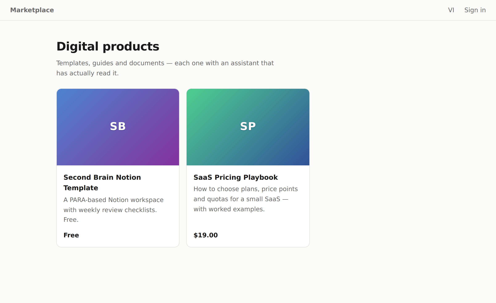
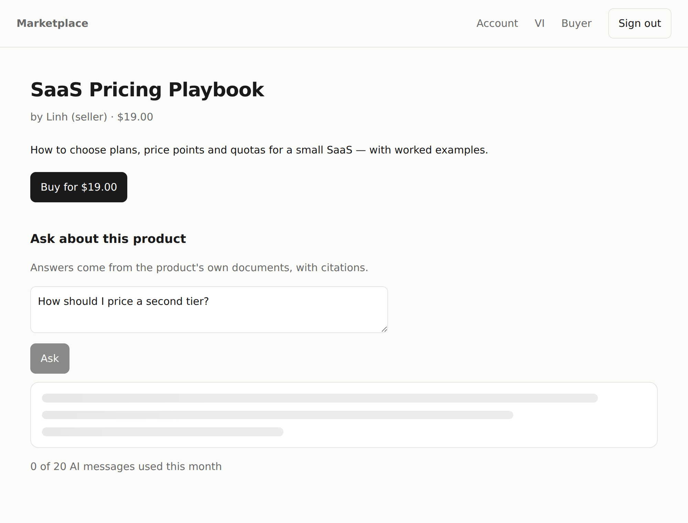
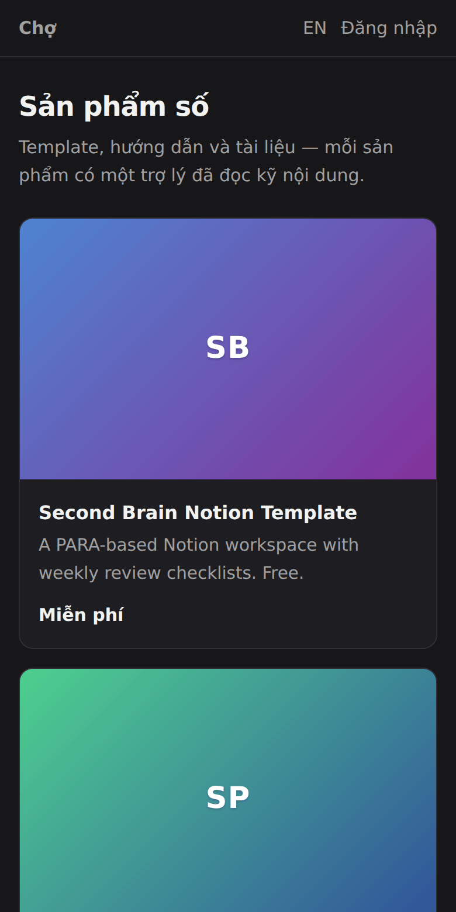
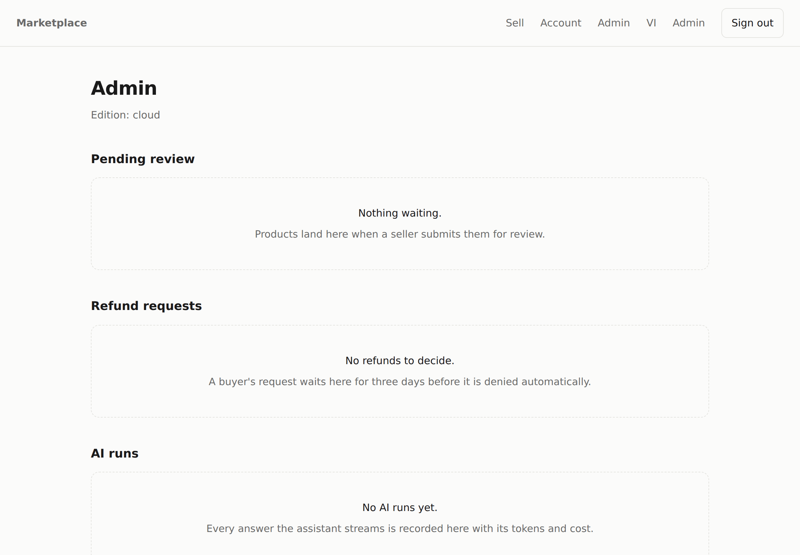

# digital-marketplace

A marketplace for digital products where every listing comes with an
assistant that has actually read it. Sellers upload a document, buyers purchase
it once or subscribe, and questions get answered from the document itself —
with citations, and inside the thread the last question started, so a
follow-up is a follow-up. Buyers rate what they paid for, once per purchase,
and a moderator decides what reaches the listing. Listing review, refunds and
seller payouts are durable workflows that wait — for a human, or for an
onboarding to finish. English and Vietnamese.

Built on four libraries extracted from it:

| Library | What it owns here |
|---|---|
| [agent-runtime](https://github.com/tientran1234/agent-runtime) | the "ask about this product" agent: tools, quota gate, streaming, tracing with cost |
| [durable-workflow](https://github.com/tientran1234/durable-workflow) | listing review (waits up to 7 days for an admin), refunds (waits for a decision, then calls the provider with retries) and seller payouts (wait for onboarding, transfer, reverse) |
| [subscription-billing](https://github.com/tientran1234/subscription-billing) | the billing design: idempotent webhooks, forward-only state machines, entitlements derived on read |
| [offline-license](https://github.com/tientran1234/offline-license) | the self-hosted edition: admin area gated by a signed license, no phone-home |

The RAG pipeline (structure-aware chunking → embeddings → pgvector → MMR
re-ranking) lives in `src/rag/` and runs on Postgres alone — no vector service.
The marketplace's own search runs there too: full-text and pgvector over the
same chunks, fused by rank.
Uploads are `.md`, `.txt` or `.pdf`; `server/extract.ts` flattens a PDF to text
before the chunker sees it, and refuses a scan with no text layer rather than
indexing an empty document. The file itself goes through `server/storage.ts`:
local disk in dev, an S3-compatible bucket (R2, MinIO, AWS S3) wherever the
`S3_*` variables are set — SigV4 signed by hand, no SDK.

## Flows

**Sign in.** `POST /api/auth/request-link` answers 204 for every address — a
different answer for one that has an account would list our customers — and
emails a link. Only the link's SHA-256 is stored: the link itself is already
in a mailbox and in whatever logged the URL, so the row on its own opens
nothing. `GET /api/auth/callback` redeems it — valid, consumed or expired,
decided in `domain/magic-link.ts` — and claims it with an `UPDATE … WHERE
consumedAt IS NULL`, so two clicks leave one winner, the same way the webhook
table's insert is the lock. The account is created there rather than when the
address was typed, because until the link comes back all anyone has done is
type an address. It is created as a BUYER: a link proves an address, it does
not hand out a role. What comes out is the same opaque session row in the same
table as before.

**Sign in with Google.** Optional, and absent until `GOOGLE_CLIENT_ID` and
`GOOGLE_CLIENT_SECRET` are both set — one of the two is an error rather than a
button that takes a buyer to Google and fails on the way back. `GET
/api/auth/oauth/start` mints a random state and a PKCE verifier, seals both
into a ten-minute httpOnly cookie signed with `SESSION_SECRET`, and sends the
browser to Google with nothing but the verifier's SHA-256. The flow waits in a
cookie rather than a table because what it has to prove is that the request
coming back is from the browser that left, and it is signed because an
unsigned state cookie can be planted by anything able to write a cookie on
this domain — and a planted state matches a planted query string. `GET
/api/auth/oauth/callback` exchanges nothing until that state has matched: the
code is a credential the provider spends once, and spending it for a callback
we cannot tie to a flow of ours is signing in whoever assembled the URL. The
profile comes from the userinfo endpoint rather than the `id_token`, and an
address Google has not verified is refused — both doors end at one `user` row
keyed by email, so an unverified address would be a way into whatever that
address already owns here. What comes out is the same `issueSession`: the role
is whatever the account already has, and the name a seller trades under is not
the provider's to overwrite on every sign-in.

**Sign in with your own provider.** The same two routes serve a second door —
an OpenID Connect provider of the operator's: Entra, Okta, Auth0, Keycloak,
GitLab. It is five variables (`OIDC_CLIENT_ID`, `OIDC_CLIENT_SECRET` and the
authorize, token and userinfo endpoints), set beside Google's or instead of
them, and `providers/oidc.ts` is the only file that knows them. The endpoints
are pasted rather than read from `<issuer>/.well-known/openid-configuration`,
because discovery is a request whose answer decides where a sign-in goes and
it would be made while a buyer waits on the redirect; three URLs set once
cannot be wrong at the moment the button is pressed, and the start route stays
a redirect with no network in it. The provider has to assert `email_verified`:
the address check is the whole of what stands between a provider's say-so and
an account here, so one that will not say is refused like any other unverified
address, and that is the thing to check before configuring a door. One
callback URL is registered for every door, which makes the flow cookie the
only record of which provider issued the code coming back — so the provider's
name is sealed into it beside the locale, and a name off the callback's query
would be whoever assembled the URL choosing whose token endpoint we offer a
code to. A door half configured is an error for all of them, because a
sign-in page quietly missing the button an operator just set up is the hardest
version of this to notice.

**Buy.** `POST /api/checkout/order` persists a `PENDING` order *before*
calling Stripe, so a webhook that beats the response still finds it. Stripe's
`checkout.session.completed` arrives at `POST /api/webhooks/stripe`: raw body
→ signature → event id claimed in `WebhookEvent` (the insert is the lock) →
`UPDATE … WHERE status IN (PENDING)`. A replayed delivery is a `duplicate`;
two racing deliveries produce one winner. Download access is one pure function
(`domain/access.ts`) used by both the button and the file route, so they can
never disagree.

**Ask.** `POST /api/products/:id/ask` streams SSE. Before the model is called:
plan check (`ask_ai`), then monthly quota incremented in the database — and
refunded if the provider fails before a single token reaches the buyer, though
a run that dies half way through an answer still costs the message. The agent
has two tools — `search_docs` (retrieve + MMR over the product's chunks) and
`product_facts` — a hard cap of six iterations, and a tracer that writes every
run's spans, tokens and cost to `AgentTrace` for the admin page.

**Remember.** A question nobody can ask a second one about is a search box with
a nicer font, so every exchange is a `ThreadTurn` row keyed to the reader and
the listing, and the agent's window is that thread: "and in euros?" resolves
against what it is a follow-up to, and the product page shows the reader what
they were told last week without their asking again. The question and the
answer are one row, because a run that died before its first token left nothing
worth remembering; the tool calls and the passages they returned are not in it
at all, since the trace already has them and `search_docs` can read page nine
again more cheaply than every later call can carry it.

Past a budget of 2,000 tokens of history, `ConversationMemory` drops whole
turns from the oldest end — whole, so no question is ever sent without the
answer it earned — and what replaces them is the questions, clipped, twenty at
most. Not the answers: a follow-up needs to know what was asked, while the
answers came out of a document that is still there to be searched. And not a
model call either, which would cost the buyer a message they never asked for
and could fail in the middle of the one they did. So the fold is a function of
the turns, derived on every call rather than written down beside the rows it
came from — the same reason entitlements are derived from a subscription here
instead of stored next to it.

**Search.** A marketplace that reads titles cannot find the listing whose
answer is on page nine, which is most of what is for sale here. So
`server/search.ts` runs two arms over the same index the assistant retrieves
from: Postgres full-text across the title, the description and every chunk,
and pgvector across the chunks, fused with reciprocal rank fusion — positions,
not scores, because a `ts_rank` and a cosine similarity cannot be added. The
arms are asymmetric and the page says so. Full text is precise and returns
nothing for a query no document contains a word of; the vector arm answers
everything and has no threshold to refuse with, so when nothing matched the
words a buyer typed the results are labelled as the closest documents rather
than left looking like matches. The card names the passage it matched on,
which is the only way a buyer can tell why a listing whose description says
nothing about dunning came back for "dunning".

The lexical arm matches every language the listing was written in — its own
words and each translation of them — because a term a seller left in English
is still the word a buyer would type for it whatever language their card is
in. Which of those texts the reader will be shown is resolved the way the card
resolves it, and a hit found in one of the others carries the language it
matched: the card says "Found in the seller's Vietnamese wording" about a
listing whose every visible word is a stranger to the query, which is the same
answer a heading gives for a passage on page nine. Two orders keep the wider
recall an addition rather than a trade. Per listing, a match in the words the
reader does get is the one reported, so a listing whose own card answers the
query is never explained away as a foreign-language hit — "SaaS" scores higher
in the English title than in the Vietnamese one, and a Vietnamese reader is
looking at the word on their own card. Across listings, the hits that needed
explaining sort after the ones that did not. The text search configuration
follows the language of the words rather than being one constant: the locale
on the row the words are on, and the listing's own for its document, since
that is the language the seller uploaded it in. Vietnamese gets `simple` —
Postgres ships no configuration for it, and `english` would both stem words
that do not inflect and swallow `an`, `do` and `can` as stop words. The query
is built in the same configuration as the text it is matched against, which one
constant quietly got wrong: the english stemmer reads "ngày" as "ngài".

**Read it in your language.** The interface was already in English and
Vietnamese while every listing in it was in one language, so a buyer on `/vi`
read Vietnamese chrome around an English card. A listing now carries the
language it was written in, and a `ProductTranslation` row per further locale
carries the seller's own words for it — their words, not a machine's, which is
why an untranslated listing falls back instead of being translated on the way
out. `domain/listing.ts` resolves which pair a reader gets, and the grid, the
product page and the assistant's prompt all go through it, so a listing cannot
be Vietnamese on the card and English on its own page. A translation counts
only with both fields written: half of one reads as a broken page rather than a
partly translated one, which is the stance the interface copy is already held
to. Where it falls back, the page says which language it fell back to rather
than letting it look chosen.

The seller's form carries the pair again for each other locale, neither field
required — a language left empty means the listing reads in its own there,
which is better than a seller padding out a translation to get past the form.
The assistant is told the locale the buyer is reading in, names the listing by
the title they can see and answers in their language whatever language the
document it quotes is in; the ask route sits outside the `[locale]` segment and
cannot see it, so the box sends it.

A seller who would rather not start from an empty box can have one drafted:
`POST /api/products/translate` turns the words already in the form into the
other locale and hands them straight back to the two fields, where they are
the seller's to correct, cut or clear. No listing is written on the way past —
the one being drafted for does not exist yet — so the draft becomes a
`ProductTranslation` row on the same submit everything else does, and what a
buyer reads is still only what a seller posted. The model is told to translate
what the listing says and author nothing: a figure, a price or a promise comes
across as written, because a claim this marketplace restated is the seller
answering for a sentence they never wrote. What comes back is held to the
bounds the submit route enforces, so a draft is never text they have to cut
down before the form will take it, and a language they have already written in
is left alone. It is one call with no repair round and no second counter — the
same monthly AI budget a buyer's question spends, refunded when no draft
arrived, traced into the same table — because a seller is waiting on a form
field and typing it was always the fallback.

**Rate.** A purchase earns one review: the `Review` row is keyed by the order,
so the unique constraint is what makes "one per purchase" hold rather than a
check that races itself — buy the document twice and you have two things to say
about it. A refund takes the purchase back and the right to review it with it.
Nothing is on the listing until an admin publishes it from the moderation
queue, so the average on the card is what a human let through; the decision is
forward-only, like an order's, so two moderators clicking leave one winner.
This one is not a workflow, unlike the listing review below it on the same
admin page: a rating waits for nothing and moves no money, so the queue is the
PENDING rows themselves rather than a run parked on a signal.

**Review a listing.** Submitting a product starts the `product-review` workflow: mark
pending, wait for the `review` signal (7-day timeout → rejected), publish or
reject. The run lives in `workflow_runs`; a deploy in between changes nothing.

**Refund.** The buyer's request starts `refund-request`: wait for an admin
`decision` (3 days → denied); on approval, `issue-refund` calls the provider
inside a retried step. The order's status is *not* changed by the workflow —
it changes when `charge.refunded` arrives, through the same webhook path as
every other status change. One place changes money state.

**Pay out.** A paid order owes its seller the price minus the platform's 10% —
`domain/payout.ts` does the split, rounding the fee down so the two halves add
back up to exactly what the buyer paid. The `seller-payout` run writes that
down before anything moves, and if the seller has not finished Stripe Connect
onboarding it parks with no timeout at all, because what someone has earned
does not expire; `account.updated` then signals it rather than leaving the money
for the next tick. The transfer is one retried step keyed by the payout id, so a
step that runs twice pays once. A refund starts `payout-reversal`, which reverses
the transfer if there was one and otherwise cancels the payout and stops the run
still waiting on it — onboarding finished after a refund does not pay for a sale
that was given back. Both runs start where the order's status changes, because
that is the one place money state moves.

**Measure.** The sell page shows each listing's views, purchases and questions
asked — a Pro feature, gated by `canUse(ent, "seller_analytics")` before the
query runs rather than after it. Two of the three numbers were already in the
database (orders, and the traces the ask box writes); views get a `ProductView`
row per product per UTC day, incremented in the database, and a seller
reloading their own listing is not an audience. A purchase is money that
stayed, so a refunded order stops counting as a sale.

**Serverless worker.** There is no resident process on Vercel, so
`POST /api/workflows/tick` processes due runs and `vercel.json` schedules it
(daily on Hobby — point cron-job.org at it every few minutes for real use). Signals (`admin approves`) resume runs immediately without
waiting for the tick.

**First boot.** A deployment with a schema and no rows looks broken rather than
new, so `SEED_ON_BOOT=1` has the app seed itself from the instrumentation hook
Next awaits before serving — the first page loaded already has the demo
products on it. Opt in, only ever into an empty marketplace, and one instance
at a time behind an advisory lock, because a cold start brings up as many
instances as it has traffic and they all find the same empty database.

## Run it

```bash
pnpm install
cp .env.example .env            # DATABASE_URL needs pgvector; Neon has it, so does `pnpm db:up`
pnpm db:setup                   # Prisma schema + vector extension + workflow table
pnpm db:seed                    # three users, two indexed products — no API keys needed
pnpm dev                        # http://localhost:3000/en  (sign-in links print to this terminal)
```

With keys: `ANTHROPIC_API_KEY` turns on the real assistant (Claude via
agent-runtime), `VOYAGE_API_KEY` turns on real embeddings (without it, a
bag-of-words hasher stands in — fine for a demo, useless for real search),
`STRIPE_*` turns on real checkout (`pnpm stripe:listen` for the webhook), and
`S3_*` moves product files off the local disk into a bucket, and
`RESEND_API_KEY` + `MAIL_FROM` send sign-in links as real email instead of
printing them, and `GOOGLE_CLIENT_ID` + `GOOGLE_CLIENT_SECRET` put a "Continue
with Google" button on the sign-in page (register
`<APP_URL>/api/auth/oauth/callback` with Google). The five `OIDC_*` variables
put a second button there for your own OpenID provider, registered at the same
callback URL. Setting some but not all of the `S3_*` variables — or one of the
two mail variables, or some of either sign-in door's — is an error rather than
a fallback.

Sign in as `buyer@`, `seller@` or `admin@example.test` to reach those screens:
the seed gives them their roles, and the link only proves the address.

```bash
pnpm test                       # 181 unit tests anywhere; 39 flow, search and first-boot tests need DATABASE_URL
pnpm test:e2e                   # the two buyer flows in Chromium — needs DATABASE_URL too
pnpm eval                       # 40 questions over the seed docs — recall@5 and answer correctness
                                # with DATABASE_URL, also search relevance per arm
pnpm typecheck && pnpm build
```

**End to end.** `e2e/` drives a production build in a browser: buy → webhook
→ download, and ask → cited answer. It covers the seams the flow tests reach
past — the button posting to the checkout route, the webhook arriving as raw
signed bytes, the file landing on disk, the agent's tool call and citations
arriving over SSE. Stripe, the model and the embedder are the same doubles the
flow tests inject, selected here by `FAKE_PROVIDERS=1` because a browser
cannot reach into the process to install them; a real key alongside that flag
is an error rather than a silent preference either way. The stand-in model can
only quote what `search_docs` returned, so the ask spec takes the passage the
answer cites and looks for it in the product's own chunks: an answer that is
not in pgvector is an answer that did not come from the document. Sign-in is
the real emailed link, read off the server's log — the only place it exists
outside a mailbox, since the database keeps its SHA-256.

**Against a deployment.** `E2E_BASE_URL=https://… pnpm exec playwright test`
runs `e2e/preview.spec.ts` instead, and a `deployment_status` workflow does it
for every Vercel preview. Those two flow specs cannot go there — they hold a
Prisma client on the same database and read the sign-in link off the server's
own log — so what a deployment is asked is what a buyer could ask it: is the
seed on the marketplace, does the locale prefix route, is the file shut to a
stranger, is an unsigned delivery refused. It is the one question CI cannot
answer, because a missing `DATABASE_URL`, a half-configured bucket and an
unseeded database all build perfectly.

**Evals.** `evals/` asks forty questions of the two seed documents, each one
naming the passage that answers it and the fact the answer must carry. It runs
the real chunker, embedder, MMR and agent prompt against an in-memory index, so
it needs no database and no key; `EVAL_MODEL=1` swaps the extractive baseline
for the real model. The search-relevance section is the exception: the lexical
arm is Postgres itself, so twenty search queries are scored per arm when
`DATABASE_URL` is set and skipped when it is not. Numbers and what they mean:
[`evals/README.md`](evals/README.md).

**Deploying it.** Vercel, Neon, a bucket, the Stripe webhook and the cron tick,
and what a preview environment needs that production must not have:
[`docs/deploy.md`](docs/deploy.md).

## The UI



Colour, space, radius and type are tokens in `app/[locale]/globals.css` and
dark mode redefines the surface, so a change is one line rather than a
find-and-replace. A product carries a document, not artwork, so its cover is
derived from the slug — a fixed gradient and the title's initials, the same on
the server and in the browser, with no column to fill and no upload to wait
for. The grid reflows to one column on a phone.

 

Retrieval runs before the assistant's first token, so the ask box shows
skeleton lines rather than a spinner that lies about how long this takes —
held still for anyone who asked for reduced motion.



Every "nothing here yet" says what is missing and what will fill it, in both
languages, instead of one grey sentence or a table of headers with no rows.

## Layout

```
src/
  domain/        pure: billing events, order + subscription + payout + review state machines, the fee split, plans, download access, who may rate a purchase, seller analytics, sign-in link rules, what a provider sign-in has to prove, which words a listing shows which reader, what a drafted translation may be
  providers/     stripe.ts (the only file importing stripe) · s3.ts (SigV4 by hand) · resend.ts (one POST) · google.ts (the only file knowing Google's endpoints) · fake.ts (the billing double, the extractive model, and the flag that serves them)
  rag/           chunk · embed (Voyage, hash) · mmr · rrf (rank fusion) · store (pgvector, raw SQL) · retrieve
  lib/           db · pg · env · money formatting · cover (the grid's derived gradients)
  server/        billing · workflows · payouts · reviews · assistant · conversations (the thread's rows) · translate (the draft a seller is offered) · search (full-text + pgvector, fused) · auth (opaque sessions) · magic-link · oauth (the signed flow cookie, and the provider seam) · mail · usage · analytics · license · storage · extract · seed (the demo data) · bootstrap + bootstrap-postgres (what a first boot owes an empty marketplace)
  app/api/       auth (request-link/callback/logout, oauth/start + oauth/callback), checkout, webhooks, products (upload/submit/ask/download/translate), orders/refund, orders/review, seller/payouts, admin (review/refund/moderation), workflows/tick
  app/[locale]/  marketplace, product, account, sell, admin, login — en + vi
  components/    the client bits: SSE reader, checkout buttons, forms · empty state · stars
tests/           domain, rag, rank fusion, the conversation window, listing fallback, drafted translations, upload extraction, storage keys + S3 signing, sign-in links + mailer choice, the provider flow (PKCE, the sealed cookie, the address check), stripe mapping, evals, the fake-provider seam, the first-boot claim, and the flows + search on real Postgres
e2e/             playwright: buy → webhook → download, ask → cited answer, in a browser · preview (a deployment, over nothing but its URL)
evals/           the assistant eval suite: questions · harness · search relevance · report
scripts/         setup-db, seed, seed-docs (the corpus the evals ask about)
docs/            deploy (Vercel + Neon + a bucket) · self-hosted (the licensed edition)
```

## What is deliberately not here

- **Searching words nobody wrote.** Every language a seller wrote a listing in
  is now searched, whichever one the reader is shown — see Search — because
  those words are in the corpus and someone typing them back is asking for
  that listing. What is not here is a query rendered into another language to
  reach a listing in a third: a buyer typing English reaches an English title
  because a seller typed it, not because anything translated either side on the
  way past, which is the same rule the listings themselves are held to. So a
  listing the seller wrote only in Vietnamese is not found by the English words
  it would have used, and the lexical arm's answer stays a set of texts that
  exist rather than one it generated — the vector arm is what still answers a
  query no document contains a word of.
- **Translating a listing the seller did not translate.** A fallback shows the
  words they wrote, and nothing renders them into the reader's language on the
  way out: a listing is what is being sold, and a machine's paraphrase of a
  price or a promise is the seller's to stand behind, not ours. A draft is
  offered to the seller instead — see Read it in your language — which is the
  same rule from the other side, because the words a buyer reads are the ones
  somebody submitted a form holding. So there is no listing translated on
  demand for a reader, no model asked to fill a locale the seller left empty,
  and nothing that treats a draft as approved because it came back clean: the
  one thing published here is what a seller posted.
- **Passwords.** Sign-in is an emailed link, or a provider where one is
  configured, and nothing else. There is no password to leak, reset or
  rate-limit. A product that needs a further door configures one — the OpenID
  door takes any provider's three endpoints — rather than writing a session
  layer beside this one, and what it would have to be is another way into
  `issueSession`, as both of these are.
- **An identity provider that will not say an address is verified, and
  anything else it knows.** A door is `email_verified` and nothing more. A
  provider that does not assert it cannot be one, however the operator
  configures it, because every door ends at one `user` row keyed by email —
  and a provider's groups, its roles and its directory are not read at
  all: a role here is granted here, and a sign-in that could promote an
  account would make whoever administers the provider an admin of this
  marketplace. Nor is an account tied to the provider id behind it, so the
  same address through either door is the same seller, and a buyer who
  switches keeps what they bought.
